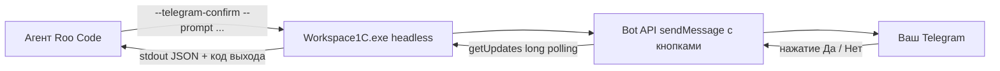

# Telegram-мост для рабочего процесса разработки

**Выпуск 1.0.0.36+** · предназначен для агентов разработки (Roo Code / Claude Code),
build-скриптов и ручного запуска из терминала.

Мост даёт две headless-команды того же исполняемого файла `Workspace1C`:

1. **`--telegram-send`** — отправить уведомление о прогрессе в Telegram (fire-and-forget);
2. **`--telegram-confirm`** — отправить запрос с inline-кнопками **«Да»/«Нет»** и блокирующе
   ждать ответа, после чего сообщить результат кодом выхода и текстом в stdout.

Это позволяет агенту держать вас в курсе работы и **не выполнять ответственные действия
(публикация релиза, коммит, запуск сборки и т.п.) без вашего подтверждения**.



---

## 1. Требования и настройка

- **Бот**: создайте у [@BotFather](https://t.me/BotFather) токен вида `123456:ABC-DEF…`.
- **Чат/канал**: куда присылать уведомления — число (личный чат), отрицательное число
  (группа), `@channel` или приватная ссылка `t.me/c/…[/тема]` (поддерживается той же логикой,
  что и окно настроек уведомлений).
- **Настройки**: заполняются один раз в окне
  **«Утилиты → Уведомления: Telegram и email»** (сохраняются в `notifications.json` профиля).
  Само приложение при вызове команд **не обязательно запущено** — работает headless CLI.
- **Как узнать свой chat_id**: напишите боту любое сообщение, затем в окне настроек нажмите
  «Проверить Telegram». При необходимости ID подскажет чат [@userinfobot](https://t.me/userinfobot).
- **Путь к исполняемому файлу** (примеры ниже используют переменную `$env:W1C_EXE`):

  | Платформа | Переменная / путь |
  |---|---|
  | Windows | `$env:W1C_EXE = "G:\…\Workspace1C.exe"` |
  | Linux | `export W1C_EXE=/opt/workspace1c/Workspace1C` |

Служебные файлы в каталоге данных профиля (они создаются автоматически):

| Файл | Назначение |
|---|---|
| `telegram.offset` | последний обработанный `update_id` — история не перечитывается при каждом запуске |
| `telegram.confirm.lock` | блокировка «один активный запрос подтверждения» (снимается по завершении/таймауту) |

### Прокси для сетей с блокировкой Telegram

В некоторых сетях провайдер фильтрует `api.telegram.org:443` (ICMP при этом проходит),
и запросы к Bot API «зависают» до таймаута. Мост умеет ходить через HTTP-прокси,
адрес которого берётся из переменной окружения (порядок приоритета):

```
W1C_TELEGRAM_PROXY → HTTPS_PROXY → https_proxy → HTTP_PROXY → http_proxy
```

Задайте локальный порт вашего прокси/VPN-клиента (например, `http://127.0.0.1:8080`,
у многих VPN-клиентов это `socks`-порт — используйте HTTP-режим своего прокси):

```powershell
# PowerShell (текущий терминал):
$env:W1C_TELEGRAM_PROXY = "http://127.0.0.1:8080"
& $env:W1C_EXE --telegram-send --text "Проверка через прокси" --json

# bash:
export W1C_TELEGRAM_PROXY="http://127.0.0.1:8080"
"$W1C_EXE" --telegram-send --text "Проверка через прокси" --json
```

Если прокси не задан (или значение пустое) — соединение идёт напрямую, как раньше.
Адрес прокси применим и к `--telegram-send`, и к `--telegram-confirm` (включая поллинг ответов).

---

## 2. Уведомление о прогрессе — `--telegram-send`

```bash
# PowerShell
& $env:W1C_EXE --telegram-send --text "Сборка 1.0.0.36 завершена успешно" --kind success --json

# bash
"$W1C_EXE" --telegram-send --text "Тесты прошли: 214/214" --kind success --json
```

| Параметр | Назначение |
|---|---|
| `--text <сообщение>` | **обязательно**; текст уведомления |
| `--title <заголовок>` | заголовок сообщения (по умолчанию «Workspace 1C») |
| `--kind info\|success\|warning\|error` | маркер вида (`ℹ️` / `✅` / `⚠️` / `❌`); по умолчанию `info` |
| `--json` | единый JSON-контракт в stdout |
| `--profile <id>` | профиль, чьи настройки каналов использовать |

Ответ при успехе (`--json`):

```json
{ "ok": true, "command": "telegram_send", "data": { "sent": true } }
```

**Важно.** Dev-уведомления **не проходят** через фильтр «какие события отправлять»
и «только ошибки» — команда отправляет всегда (при настроенном канале): разработчик явно
попросил уведомить. При ненастроенном канале — ошибка `not_configured` (код 1).

---

## 3. Подтверждение — `--telegram-confirm`

```bash
# PowerShell: перед публикацией релиза
& $env:W1C_EXE --telegram-confirm --prompt "Опубликовать релиз 1.0.0.36?" --button "Да, публиковать" --button "Нет" --timeout 300 --json
```

| Параметр | Назначение |
|---|---|
| `--prompt <вопрос>` | **обязательно**; текст запроса в Telegram |
| `--button <текст>` | тексты кнопок (повторяемый): **1-я — «Да»**, **2-я — «Нет»**; по умолчанию «Да» / «Нет» |
| `--timeout <сек>` | сколько ждать ответа (по умолчанию 300 с; после таймаута сообщение помечается «⏰ Время ожидания истекло», кнопки снимаются) |
| `--json` | единый JSON-контракт в stdout |
| `--profile <id>` | профиль с настройками каналов |

При нажатии кнопки бот выполняет `answerCallbackQuery` и заменяет текст сообщения на
**«✅ Подтверждено»** или **«❌ Отклонено»** (кнопки исчезают), поэтому повторные ответы невозможны.

Ответы (`--json`):

```json
{ "ok": true, "command": "telegram_confirm", "data": { "result": "yes" } }
{ "ok": true, "command": "telegram_confirm", "data": { "result": "no" } }
{ "ok": true, "command": "telegram_confirm", "data": { "result": "timeout" } }
```

### Коды выхода

| Код | Значение |
|---|---|
| **0** | `yes` — подтверждено, рабочий процесс может продолжать |
| **4** | `no` — отклонено, рабочий процесс должен остановиться |
| **5** | `timeout` — ответа не было за `--timeout` секунд |
| **1** | ошибка: канал не настроен (`not_configured`), уже идёт активный запрос (`busy`), сбой отправки (`send_failed`), невалидные аргументы |

Пример ветвления в PowerShell:

```powershell
& $env:W1C_EXE --telegram-confirm --prompt "Публикуем?" --timeout 300 --json
switch ($LASTEXITCODE) {
  0 { "Продолжаем" }
  4 { "Остановлено пользователем" }
  5 { "Таймаут" }
  default { "Ошибка: $LASTEXITCODE" }
}
```

---

## 4. Как агенту (Roo Code) использовать мост

Правило для инструкций агента (поместите в `.claude/settings/…` / правила проекта):

> **Telegram-уведомления и подтверждения.**
> Перед ответственным действием (публикация релиза, `gh release create`, массовый `git push`,
> запуск долгой сборки/тестов) запроси подтверждение:
> `—telegram-confirm --prompt "<что делать?>" --json`:
> код 0 — продолжай; 4 — остановись; 5 — сообщи о таймауте и спроси пользователя; 1 — сообщи об ошибке.
> О значимых событиях (старт задачи, успешная сборка/тесты, выпуск релиза) присылай
> `--telegram-send --text "…" --kind success|warning|error --json`.

**Ограничения моста (осознанные):**

- Одновременно выполняется **один** активный запрос подтверждения (`busy`, если занят);
- long polling живёт **только внутри процесса `--telegram-confirm`** — фонового поллера в
  приложении нет, поэтому конфликт `getUpdates` с другими участниками исключён;
- ответы из чатов, **отличных от настроенного**, игнорируются (защита от подмены);
- токен бота не попадает в журнал и тексты ошибок (маскируется);
- если процесс-владелец подтверждения упал жёстко, блок `telegram.confirm.lock` через
  минуту после таймаута считается устаревшим и перезаписывается.

---

## 5. Быстрая самопроверка

```bash
# 1) Канал настроен?
& $env:W1C_EXE --telegram-send --text "Проверка моста" --kind info --json
# 2) Интерактивное подтверждение (нажмите кнопку в Telegram):
& $env:W1C_EXE --telegram-confirm --prompt "Это тестовый запрос подтверждения?" --timeout 60 --json
```

Если пункт 1 вернул `not_configured` — откройте окно «Уведомления: Telegram и email»,
вставьте токен и ID чата, нажмите «Проверить Telegram», сохраните.

---

## 6. Расширенный CLI и MCP-сервер (выпуск 1.0.0.88, п.6)

Кроме telegram-команд тот же headless-исполняемый файл поддерживает:

| Команда | Назначение |
|---|---|
| `--backup <база>` / `--backup-all` | Резервная копия одной/всех баз (есть с 0.3.9.220; `--json` — единый контракт) |
| `--update [--apply]` | Проверка обновления через GitHub Releases; `--apply` — скачивание сборки и маркер применения при следующем запуске |
| `--eventlog --target <база/каталог> [--from --to --user --event --text --limit]` | Выборка из журнала регистрации (JSON: `data.entries`) |
| `--check` | Диагностика окружения/конфигурации (версия, каталог данных, платформы 1С, rac/ring, процессы, службы, права) |
| `--mcp` | MCP-сервер по stdio (см. [`docs/mcp.md`](mcp.md)) |

```bash
# Проверка/применение обновления
& $env:W1C_EXE --update --json
& $env:W1C_EXE --update --apply --json
# Журнал регистрации файловой базы (последние 20 записей)
& $env:W1C_EXE --eventlog --target "Бухгалтерия" --limit 20 --json
# Диагностика окружения
& $env:W1C_EXE --check --json
```

**MCP-сервер** (`--mcp`, JSON-RPC 2.0 по stdio) открывает ИИ-агентам инструменты:
`list_infobases`, `launch_infobase`, `clone_infobase`, `event_log_query`,
`server_sessions`, `scheduled_jobs_state` и опасный `terminate_session` с
подтверждением через механизм этой страницы (`TelegramConfirmationService` —
inline-кнопки «Да/Нет»). Опасные операции выполняются только после нажатия «Да»;
результат подтверждения включается в ответ инструмента. Полная документация со
схемами параметров — в [`docs/mcp.md`](mcp.md).
