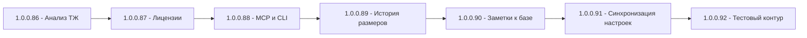

# План: задачи 4–10 (релизы 1.0.0.86 – 1.0.0.92)

Дата: 2026-10-27. Текущая версия: **1.0.0.85** (10-27).

Порядок выпусков строго последовательный; каждый пункт — **отдельная задача**, каждый релиз
собирается отдельно (Windows + Linux single-file), публикуется на GitHub и анонсируется в
Telegram (чат **-1004425443528**). Issues на GitHub **не закрываются** (номера придут от
пользователя перед запуском каждой задачи).

> Согласовано с пользователем: версии 1.0.0.86 – 1.0.0.92 строго по порядку,
> привязка к issues не требуется, номера issues предоставляются отдельно.

---

## Общий процесс для каждой задачи (обязательный чек-лист)

1. Реализация фичи (WPF + Avalonia, локализация, тесты).
2. Покрытие юнит-тестами в `Workspace1C.Tests` (чистые функции — парсеры/расчёты).
3. Обновление:
   - [`VersionInfo.cs`](Workspace1C/VersionInfo.cs) — версия 1.0.0.NN;
   - [`CHANGELOG.md`](CHANGELOG.md) — секция `## [1.0.0.NN] — дата`;
   - [`README.md`](README.md) — если фича пользовательская;
   - [`docs/telegram-dev-bridge.md`](docs/telegram-dev-bridge.md) — если меняется CLI/контракт.
4. Сборка исполняемых файлов:
   - Windows: `Workspace1C/build-windows-single-file.ps1`;
   - Linux: `Workspace1C/build-linux-single-file.sh`.
5. Публикация: коммит, push, релиз через `tools/publish-release.ps1 -Version 1.0.0.NN -Sha <sha>`.
6. Новость в Telegram (чат `-1004425443528`) по шаблону прошлых релизов
   (`_send_telegram_v1000NN.ps1`, текст — краткая выдержка из CHANGELOG).
7. Итоговые артефакты в корне: `_rel_notes_v1000NN.md`, `_telegram_msg_v1000NN.txt`,
   `_send_telegram_v1000NN.ps1`, `_publish_v1000NN.cmd`.

---

## Задача 1 → 1.0.0.86: п.4 — Анализ технологического журнала

### Требования

- В окне «Технологический журнал» ([`TechLogViewModel.cs`](Workspace1C/ViewModels/TechLogViewModel.cs),
  [`TechLogWindow`](Workspace1C/Views/)) рядом с существующей настройкой logcfg.xml добавляется
  кнопка **«Анализировать»** — разбор уже собранных логов из `LogDirectory`.
- Топы долгих операций по событиям:
  - `CALL` (долгие вызовы серверных методов);
  - `DBMSSQL` (долгие SQL-запросы);
  - `SDBL` (долгие запросы языка запросов).
- Управляемые блокировки и взаимоблокировки: `TLOCK`, `TDEADLOCK`.
- Исключения `EXCP` с **группировкой по контексту** (метод/строка/описание — нормализованный
  ключ, без динамических данных: длительности, времени, имён временных таблиц).
- Фильтры: **по базе** (`p:processName`/контекст ИБ) и **по пользователю** (`usr`).
- **Экспорт в CSV** через существующий [`CsvExporter.cs`](Workspace1C/Services/CsvExporter.cs).
- Окно анализа: таблицы топов, фильтры, кнопка экспорта; Avalonia-версия через
  `.Avalonia.cs` (по конвенции проекта).

### Уже есть (переиспользуем)

- [`TechLogService.cs`](Workspace1C/Services/TechLogService.cs) — шаблоны logcfg.xml, каталог логов.
- [`CsvExporter.cs`](Workspace1C/Services/CsvExporter.cs), `MarkdownRenderer`.
- Конвенция окна: `Views/TechLogWindow.xaml` + `TechLogWindow.Avalonia.cs`.

### Новое

- `Services/TechLogParser/`:
  - `TechLogEvent.cs` (тип события, время, база, пользователь, длительность, контекст);
  - `TechLogReader.cs` (построчное чтение `.log`-файлов, разбор `<свойство=значение>`);
  - `TechLogAnalyzer.cs` (агрегация топов, группировка EXCP по нормализованному контексту);
  - `TechLogQuery.cs` (фильтры: база, пользователь, период, типы событий).
- `ViewModels/TechLogAnalysisViewModel.cs`, окно `Views/TechLogAnalysisWindow`.
- Кнопка «Анализировать» в существующем окне ТЖ.
- Тесты: `Workspace1C.Tests/TechLogParserTests.cs` (разбор строк ТЖ, топы, группировка EXCP).

### Нюансы

- Формат строк ТЖ: `20231010 120000.123- duration=... process=... usr=... DbmsSql: ...` —
  парсер должен быть устойчивым к разным наборам свойств.
- EXCP-контекст: убирать из текста длительности/счётчики перед построением ключа группы.

---

## Задача 2 → 1.0.0.87: п.5 — Мониторинг лицензий

### Требования

- Сколько лицензий занято на сервере и **кем**: команда rac `session list` с параметром
  `--licenses` (проброс новых полей: тип лицензии, занято лицензий сеансом).
- Какие программные лицензии установлены: `ring license list` (параллельные процессы,
  вывод на Windows/Linux через существующий `ProcessRunner` / `RingService`).
- Порог **«осталось меньше N»** — отправка в существующий канал оповещений
  ([`NotificationDispatcher`](Workspace1C/Services/NotificationDispatcher.cs),
  [`INotificationChannel`](Workspace1C/Services/INotificationChannel.cs), Telegram/email).
- Место: вкладка монитора серверов ([`ServerMonitorViewModel.cs`](Workspace1C/ViewModels/ServerMonitorViewModel.cs))
  + проверка по расписанию параллельно с существующими alert-задачами
  ([`ServerAlertsService.cs`](Workspace1C/Services/ServerAlertsService.cs)).

### Уже есть

- `IRacClient` / [`RacClient.cs`](Workspace1C/Services/RacClient.cs) — `GetSessionsAsync`;
- `RacSessionInfo` (нужно расширить полями лицензий);
- канал оповещений Telegram + email, `ServerAlertsService`.

### Новое

- `RacLicensedSession.cs` / расширение `RacSessionInfo` полями лицензии
  (`app-id`, `lic-type`, `max-licenses`, `session-id`, `user-name` и т.п.);
- `Services/RingLicenseService.cs` — `ring license list` (Windows), LicenseTool на Linux
  (`/opt/1cv8/*/x86_64/utils/licensetool` или `ring` на Linux);
- `Services/LicenseManager.cs` — расчёт занятых/свободных лицензий, порог, событие в нотификатор;
- UI: секция лицензий в мониторе сервера + настройка порога в настройках оповещений;
- Тесты: парсинг вывода `rac session list --licenses` и `ring license list`, логика порога.

### Нюансы

- Вывод `ring license list` зависит от платформы; парсер должен допускать оба формата.
- Порог задаётся в настройках (0 — отключено), проверка — при открытии окна и по
  расписанию; повторное оповещение — не чаще раза в N часов.

---

## Задача 3 → 1.0.0.88: п.6 — MCP-сервер и расширение CLI

### Требования

- Режим **`--mcp`** (stdio, JSON-RPC 2.0 + MCP-протокол) — инструменты для ИИ-агентов:
  1. список баз (`--list`-логика);
  2. запуск базы (`--run`);
  3. копия базы (существующий механизм дублирования);
  4. журнал регистрации (существующие `EventLog`-сервисы: lgd/lgf);
  5. сеансы сервера (`IRacClient.GetSessionsAsync`);
  6. состояние заданий по расписанию (`IScheduledTaskStore` / `SchedulerService`).
- **Опасные операции** (удаление базы, завершение сеансов, изменение расписаний) —
  подтверждение через уже реализованный `--telegram-confirm`
  ([`TelegramConfirmationService`](Workspace1C/Services/TelegramConfirmationService.cs)).
- Расширение обычной CLI: `--backup` (уже есть с 0.3.9.220 — проверить и задокументировать),
  добавить **`--update`** (проверка/применение обновления), **`--eventlog`** (выборка из журнала
  регистрации с фильтрами), **`--check`** (диагностика окружения/конфигурации по образцу
  `Preflight`/`NetworkDiagnosticsService`).

### Уже есть

- CLI: [`CliArgs.cs`](Workspace1C/Services/CliArgs.cs), [`CliCommands.cs`](Workspace1C/Services/CliCommands.cs),
  [`CliEntryPoint.cs`](Workspace1C/Services/CliEntryPoint.cs), `--json`-контракт
  ([`CliOutput.cs`](Workspace1C/Services/CliOutput.cs));
- `EventLog` сервисы (JournalLocation/location, lgd/lgf ридеры);
- `--telegram-confirm`, `--telegram-send`, `WebDavUploader`, дублирование баз.

### Новое

- `Services/Mcp/`:
  - `McpServer.cs` — stdio-цикл: чтение JSON-RPC-сообщений, `initialize`/`tools/list`/
    `tools/call`, ответы `McpResult`;
  - `McpToolRegistry.cs` — регистрация 6 инструментов со схемами параметров;
  - `McpSafetyGate.cs` — обёртка опасных инструментов через `--telegram-confirm`
    (переиспользует `TelegramConfirmationService`, который уже работает в headless-процессе).
- Разбор `--mcp` в [`CliArgs.cs`](Workspace1C/Services/CliArgs.cs) и перенаправление из
  [`CliEntryPoint.cs`](Workspace1C/Services/CliEntryPoint.cs) **до** инициализации UI
  (аналогично текущему headless-перехвату).
- CLI-команды: `Update`, `Eventlog`, `Check` (+ их обработчики и JSON-контракты).
- Документация: `docs/telegram-dev-bridge.md` → раздел MCP, `docs/mcp.md` со схемами инструментов.
- Тесты: парсер аргументов `--mcp`, JSON-RPC-цикл (запрос→ответ), разграничение опасных
  инструментов, обработчики новых команд.

### Нюансы

- MCP-сервер в .NET без внешних зависимостей (чистые `Console.In/Out` + JSON);
- Опасные операции не выполнять без явного `approved` от `--telegram-confirm`;
- Для Linux `Program.cs` перехват — до Avalonia (уже так сделано для CLI).

---

## Задача 4 → 1.0.0.89: п.7 — История размеров баз и прогноз диска

### Требования

- Хранение **снимков размеров по дням** (не только текущий кеш
  [`FileSizeCacheEntry`](Workspace1C/Models/FileSizeCacheEntry.cs));
- График роста в **«Центре обслуживания»**
  ([`MaintenanceCenterViewModel.cs`](Workspace1C/ViewModels/MaintenanceCenterViewModel.cs),
  [`MaintenanceCenterWindow`](Workspace1C/Views/MaintenanceCenterWindow.xaml));
- Прогноз **«диск под копиями закончится примерно через N дней»** — линейная экстраполяция
  по снимкам (или по скорости роста каталога копий), с оповещением заранее (порог дней,
  кнопка «Копии» — каталог копий/WebDAV объём);
- Сбор снимков: при штатных операциях (замеры размеров уже происходят) + по расписанию.

### Уже есть

- `FileSizeCacheEntry`, `InfobaseDiskScanner`, `MaintenanceCenterViewModel/Window`,
  `DiskFreeSpaceHelper`, каналы оповещений, `SchedulerService`/`ScheduledTaskStore`.

### Новое

- `Models/SizeSnapshotEntry.cs` (дата, id базы, размер, объём копий, свободно на диске);
- `Services/SizeHistoryStore.cs` (ротация по дням, `<maxDays>` в настройках);
- `Services/DiskForecastService.cs` (линейная регрессия/наименьшие квадраты по снимкам;
  оценка «останется N дней»);
- UI: панель/график в «Центре обслуживания» (WPF + Avalonia), колонка «рост за N дней»;
- Алерт «диск закончится через N дней» через `NotificationDispatcher`;
- Тесты: ротация снимков, экстраполяция, граничные случаи (нет данных/диск растёт).

### Нюансы

- Снимки только для существующих баз (база удалена — снимки можно чистить по возрасту);
- Экстраполяция: брать последние N>=2 точек, игнорировать нулевые/битые замеры;
- Опечалять: «примерно N дней» — с погрешностью, указывать диапазон.

---

## Задача 5 → 1.0.0.90: п.8 — Заметки к базе

### Требования

- **Markdown-карточка** у каждой базы: для кого база, контакты, особенности обновления;
- **Зашифрованное поле** паролей к внешним сервисам (DPAPI/ProtectedData на Windows,
  совместимый механизм на Linux — aes по ключу пользовательского профиля или
  `ProtectedData` через провайдер);
- Заметки включаются в **поиск** (поиск баз/команд — `CommandPalette`/фильтр) и в
  **HTML-отчёт** ([`HtmlReportExporter.cs`](Workspace1C/Services/HtmlReportExporter.cs));
- Перенос через **общие списки** (передавать заметки как сопутствующие данные/импорт);
- Рендер Markdown — уже есть [`MarkdownRenderer.cs`](Workspace1C/Services/MarkdownRenderer.cs).

### Уже есть

- `MarkdownRenderer`, `HtmlReportExporter`, `InfobaseLinkStorage`/`InfobaseJsonTransfer`,
  `CommandPaletteViewModel`, поиск по базе, `SensitiveDataMasker`, `PasswordHasher`.

### Новое

- `Models/InfobaseNote.cs` (id базы, markdown-текст, секрет-поля, updated, encrypted);
- `Services/CryptoService.cs` / `StringCipher` — шифрование полей (Windows `ProtectedData`,
  Linux — AES-GCM с ключом из профиля);
- `Services/NoteStore.cs` (FileDataStore-подобное хранилище `infobase_notes.json`);
- UI: окно «Заметки» (WPF + Avalonia), пункт в контекстном меню и в карточке базы;
- Включение в поиск (`CommandPalette`) и в HTML-отчёт (секция «Заметки»);
- Общие списки: поля заметок в `ibases.v8i`-экспорт/импорт или отдельный файл заметок
  рядом с общим списком (по согласованию с реализацией п.9 — не конфликтовать);
- Тесты: шифрование/расшифровка (round-trip), поиск, включение в отчёт.

### Нюансы

- Секреты никогда не логировать; маскировка в выводе (`SensitiveDataMasker`);
- Если ключ недоступен (переезд между ПК) — выводить «зашифровано, ключ недоступен»,
  не падать.

---

## Задача 6 → 1.0.0.91: п.9 — Синхронизация своих настроек между компьютерами

### Требования

- Двусторонняя синхронизация **своего списка, групп, тегов, сценариев и горячих клавиш**
  через **WebDAV** (клиент уже есть — [`WebDavUploader`](Workspace1C/Services/WebDavUploader.cs)))
  или сетевую папку;
- Разрешение конфликтов **по времени изменения** (last-write-wins), файлы:
  `ibases.v8i` (личный), теги/группы (структура в настройках), `script_scenarios`,
  `custom_actions`, `context_menu_layout`, `hotkeys`.
- Не конфликтовать с п.5/п.8: синхронизация только настроек пользователя;
- Ручная кнопка синхронизации + по расписанию.

### Уже есть

- `SharedListService` (чтение центрального ibases.v8i — только чтение, не путать);
- `ProfileService`, `FeatureDataStore` (per-profile данные), `WebDavUploader` (PUT/MKCOL);
- `IScriptScenarioStore`, `CustomActionsStore`, `ContextMenuLayoutStore`,
  `TrayMenuLayoutStore`, `IbasesV8iExporter/Importer`, `ServerListStore`.

### Новое

- `Services/Sync/SyncTarget.cs` (WebDAV URL/сетевая папка, credentials, интервал);
- `Services/Sync/SettingsSyncService.cs`:
  - упаковка набора файлов в архив (zip) или пофайловая синхронизация;
  - сравнение по последнему изменению файла + ETag/дата;
  - last-write-wins + резервная копия проигравшей версии `*.conflict-<дата>`;
- `ViewModels/SettingsSyncViewModel` + окно «Синхронизация настроек» (WPF + Avalonia) —
  настройка WebDAV, кнопка «Синхронизировать сейчас», журнал операций;
- интеграция с расписанием (`SchedulerService`);
- Тесты: выбор победителя по времени, конфликт-файлы, маскировка паролей в логе.

### Нюансы

- Не синхронизировать `logcfg.xml`/секреты/локальные пути (каталоги баз могут отличаться);
- WebDAV-клиент расширить: GET/HEAD/PROPFIND (сейчас только загрузка);
- Пароли WebDAV — через существующее шифрование настроек (как в DbmsBackupService).

---

## Задача 7 → 1.0.0.92: п.10 — Тестовый контур одной кнопкой

### Требования

- Сценарий **«Развернуть тестовую копию»**, связывающий готовые куски:
  1. свежая копия `.dt` (moving `BackupService` / `IbcmdService` — движок выгрузки уже есть);
  2. новая база на сервере (`IRacClient.CreateInfobaseAsync`) или файловая (`CreateInfobaseService`);
  3. загрузка копии (`RestoreAsync`);
  4. отключение регламентов в копии (см. п.3 — `ScheduledJobsService`, уже в 1.0.0.85);
  5. смена заголовка и цвета базы (различимость с рабочей);
  6. добавление в группу **«Тест»** (автосоздание группы).
- Возможность запуска **по расписанию** («каждый понедельник обновлять тест из прода»)
  — через `ScheduledTaskStore`/`SchedulerService` как тип задания.
- Кнопка/пункт меню «Развернуть тестовую копию» с мастером параметров.

### Уже есть

- `BackupService` (dt), `IbcmdService` (движок 1.0.0.84), `IRacClient.CreateInfobaseAsync`,
  `CreateInfobaseService`, `ScheduledJobsService` (1.0.0.85 — отключение регламентов в копии),
  `GroupEditWindow`/иерархия групп, `BackupScenario`/`SchedulerService`, «Дублировать базу»
  (1.0.0.85), цвет баз уже поддерживается (`Group.Color`, цвет базы).

### Новое

- `Models/TestDeployScenario.cs` (исходная база, имя тестовой, движок выгрузки,
  сервер/файл, отключение регламентов, цвет, группа «Тест»);
- `Services/TestDeployService.cs` — оркестрация шагов с журналом прогресса и откатом
  при ошибке шага;
- `ViewModels/TestDeployViewModel.cs` + мастер-окно (WPF + Avalonia);
- Тип задания по расписанию в `ScheduledTaskStore` (поле `Scenario`/`Kind`,
  «обновлять тест еженедельно»);
- Тесты: последовательность шагов, построение имени тестовой базы, откат.

### Нюансы

- Переиспользовать логику «Дублировать базу» + «отключение регламентов в копии» из 1.0.0.85;
- Тестовую базу помечать так, чтобы её нельзя было перепутать с рабочей (цвет/суффикс),
  при повторном развёртывании — пересоздание или обновление по выбору.

---

## Схема последовательности релизов

Каждый узел — отдельная задача в Code-режиме, собственная сборка, релиз на GitHub и
новость в Telegram-канал -1004425443528. Issues не закрываются.

## Критерии готовности каждой задачи

- Версия в `VersionInfo.cs` увеличена на 1 (только последнее число);
- `CHANGELOG.md` и `README.md` обновлены; `docs/telegram-dev-bridge.md` — при изменении CLI;
- Сборки Windows и Linux созданы и проверены (запуск/`--help`);
- Коммит + push; релиз на GitHub с ассетами и описанием;
- Новость о релизе отправлена в Telegram-чат -1004425443528.