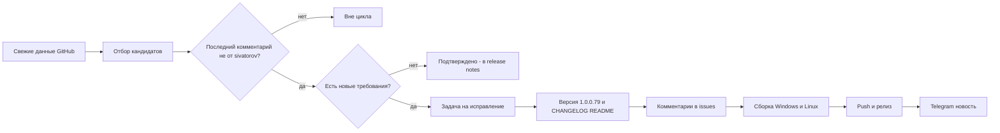

# План исправлений для версии v1.0.0.79

Репозиторий: https://github.com/sivatorov/Workspace1C
Рабочая копия: `g:/h/Workspace1C` (ветка `main`)
Текущая версия: **v1.0.0.78** → целевая: **v1.0.0.79** (увеличиваем ТОЛЬКО последнее число; в [`Workspace1C.csproj`](Workspace1C/Workspace1C.csproj:62) четыре тега: `Version`/`AssemblyVersion`/`FileVersion`/`InformationalVersion`).

## Правило отбора

Проанализированы **все 6 открытых issues** (данные GitHub API от 2026-10-26). В работу берутся только те, где **нет комментариев** или **последний комментарий НЕ от `sivatorov`**. Issues **не закрываем** — только комментарий «Исправлено в 1.0.0.79 …».

| Issue | Название | Последний комментарий | Решение |
|-------|----------|----------------------|---------|
| #69 | Удаление из кластера | @sivatorov 14:07 (фикс 1.0.0.78) | вне цикла |
| #63 | Доработка публикации баз | @sivatorov 14:08 (фикс 1.0.0.78) | вне цикла |
| #57 | Общая авторизация | @7OH 10-25 17:08 «Есть - теперь раздельно» — подтверждение | правок кода нет — упоминание в release notes |
| #55 | Поправить формы | @ArtyoZ 13:20: «Все те же формы как обрезались, так и обрезаются… прикладываю лишь Настройки» | **Исправляем** |
| #41 | Миграция баз | @7OH 14:29: «вот ещё пример, похоже вместо счётчика оно берёт текущий номер в списке» | **Исправляем** |
| #26 | Акцентные цвета/контрастность | @ArtyoZ 13:23: «Опять беда с контрастностью…» (скриншот) | **Исправляем** |

## Принципы

1. **Двухплатформенность.** Каждая правка — WPF (Windows) и Avalonia (Linux): чистая логика (сервисы/VM/парсеры) общая + юнит-тесты; представления — парные файлы `*.xaml`/`*.xaml.cs` и `*.axaml`/`*.Avalonia.cs`.
2. **Тесты-стражи.** После каждой правки — юнит-тесты в `Workspace1C.Tests/` по образцу существующих (`Issue55WindowLayoutTests`, `ClusterMigrationViewModelTests`, `AccentColorIssue26Tests`).
3. **Обратная совместимость.** Не ломать старые конфиги и локализацию ru/en.
4. **Issues не закрываются** — фиксируем факт в комментариях и release notes.
5. **Версия** увеличивается один раз на цикл: 1.0.0.78 → **1.0.0.79**.
6. **Каждый пункт — в новой задаче** (`new_task`), планирование — в режиме Архитектора.

---

## 1. Issue #55 — «Поправить формы и элементы» · объём M

### 1.1. Требования (последний комментарий ArtyoZ от 2026-10-26 13:20)

«Не подтверждаю. Все те же формы как обрезались, так и обрезаются… прикладываю лишь Настройки» (+ скриншот `Настройки`). Проблема из описания issue: при уменьшении размеров форм `Настройки` и `Настройка информационной базы` элементы на форме обрезаются; в v1.0.0.77 это заявлено исправленным («аудит всех форм, Min-размеры»), но пользователь не подтверждает.

Скриншоты из комментария 07:04 (предыдущая итерация) — формы `Настройки` (603×720), `Настройка информационной базы` (460×780), `Сменить платформу` (181×208), `Выбор родительской группы` (303×620).

### 1.2. Текущий код

- [`SettingsWindow.xaml`](Workspace1C/Views/SettingsWindow.xaml:14) — `Width=960, MinWidth=820, MinHeight=620`; вкладки обёрнуты в `ScrollViewer` (вертикальный), но **горизонтальная прокрутка отключена** (`HorizontalScrollBarVisibility="Disabled"`) в большинстве вкладок — при узком окне контент справа обрезается.
- [`ConnectionSettingsWindow.xaml`](Workspace1C/Views/ConnectionSettingsWindow.xaml:12) — `Width=760, MinWidth=680, MinHeight=680`; табы в ScrollViewer, но колонки `Auto`/`*` без минимальной ширины у полей; комбобоксы с фиксированной шириной (`Width="220"` и т.п.); нижняя панель кнопок фиксированной ширины (140px).
- Известные фиксы 1.0.0.66/1.0.0.77 уже есть: колонка подписей `Auto`+Min в ConnectionSettings, ScrollViewer в «Платформах», Min-размеры PlatformChangeWindow/GroupPickerWindow.

### 1.3. Конкретные правки

1. **Диагностика:** запустить приложение (или открыть скриншоты из комментариев), воспроизвести уменьшение форм до Min; найти, какие конкретно элементы обрезаются (вертикально/горизонтально).
2. **Горизонтальная адаптивность:** в проблемных вкладках включить `HorizontalScrollBarVisibility="Auto"` или, что лучше, перевести жёсткие ширины на `Auto` + `MinWidth`, `MaxWidth`; длинные подписи — `TextWrapping="Wrap"`.
3. **`SettingsWindow`:** проверить каждую вкладку (Общие, Платформы, Список баз, Контекстное меню, Цветовое оформление, Горячие клавиши, Резервное копирование, Учётные записи, Подписи, Шаблоны, О программе); убрать горизонтальное обрезание; для вкладки «Платформы» прокрутка нижнего блока уже есть — сверить.
4. **`ConnectionSettingsWindow`:** заменить фиксированные ширины комбобоксов на `MinWidth`/`*`; проверить колонку подписей (`Auto` + MinWidth) и метки чекбоксов «Размер вручную»/«Приватная база» (`TextWrapping`, `Margin`, размещение).
5. **Аудит остальных окон** предыдущего фикса 1.0.0.77 (меню, ConfigDiffResult, CloneServerInfobase, CreateInfobase, ServerEdit, LaunchParameter, RacInfobase…): формы с фиксированными `Width`/`Height` у элементов внутри изменяемого окна — перевести на адаптивные.
6. **Тесты:** расширить `Issue55WindowLayoutTests` (или новый класс) — проверить, что при Min-размерах окна ключевые элементы клипаются (не выходят за границы), метки переносятся; для WPF — разметочная инспекция XAML (по образцу `Issue41WindowLayoutTests`).

### 1.4. Риски

- Изменение раскладки не должно ломать код-сгенерированные вкладки (`SettingsWindow.Accounts.cs`, `SettingsWindow.Profile.cs`) — имена `x:Name` сохраняются.
- Не «растянуть» окна слишком широко: для узких экранов оставить ScrollViewer как fallback.

---

## 2. Issue #41 — «Миграция баз» · объём S

### 2.1. Требования (последний комментарий 7OH от 2026-10-26 14:29)

«вот ещё пример, похоже вместо счётчика оно берёт текущий номер в списке». Пользователь видит в прогрессе «N из M», где N — позиция строки в ПОЛНОМ списке, а не порядковый номер обрабатываемой базы. Ожидание: счётчик обрабатываемых отмеченных баз «1 из K», «2 из K» …

### 2.2. Текущий код

- [`ClusterMigrationViewModel.MigrateAsync`](Workspace1C/ViewModels/ClusterMigrationViewModel.cs:1004) — строка 1120: `listIndex = SourceRows.IndexOf(row) + 1`; строка 1125: `ProgressIndex = listIndex`; строка 1111: `ProgressTotal = SourceRows.Count`.
- В v1.0.0.78 сознательно сделано «ProgressIndex — позиция в полном списке, чтобы не смещался при снятых галочках», но пользователь хочет счётчик попыток.

### 2.3. Конкретные правки

1. `ProgressIndex = processed` (i+1) — порядковый номер обрабатываемой базы в текущем прогоне.
2. `ProgressTotal = rows.Count` — количество отмеченных баз в текущем прогоне (не `SourceRows.Count`).
3. Аккуратно с учётом «не смещается при снятии галочек и повторном запуске»: rows фиксируется в начале `MigrateAsync`, значит стабильно в рамках прогона; `ProcessedCount` оставить как есть (или убрать дублирование).
4. **Тесты:** `ClusterMigrationViewModelTests` — обновить/добавить: после снятия галочки первой базы прогресс показывает «1 из N» для первой обрабатываемой, `ProgressIndex == i+1`, `ProgressTotal == rows.Count`; защитный тест «прогресс не уезжает при повторном запуске».

### 2.4. Риски

- Проверить, что `ProgressText` и окно используют `ProgressIndex`+`ProgressTotal` (а не `ProcessedCount`): при необходимости синхронизировать каждое обновление в одном `Dispatch`.

---

## 3. Issue #26 — «Акцентные цвета и контрастность» · объём S/M

### 3.1. Требования (последний комментарий ArtyoZ от 2026-10-26 13:23)

«Опять беда с контрастностью…» (+ скриншот, 560×482). Пользователь ранее подтвердил 1.0.0.66 (контраст текста выбранного пункта левой панели Настроек), но нашёл новый элемент с плохой контрастностью.

### 3.2. Порядок действий

1. **Получить скриншот из комментария** (вложение `user-attachments` — GitHub блокирует анонимный доступ). Использовать локальный GitHub CLI (`gh api`) или скрипт по образцу `_collect_issues.ps1`; скачать картинку в `screenshots/` и проанализировать, какой именно элемент неконтрастен.
2. **Если скриншот недоступен** — уточнить у пользователя в комментарии к issue (не закрывая) или по аналогии с предыдущими жалобами: контраст текста на акцентной «шапке» (`AccentTextBrush`), текст в `ModernTextBox`/`ModernComboBox` на `InputBackgroundBrush`, подписи рядом с цветами, `TreeSelectedTextBrush` — проверить, что кисти применяются и в новых окнах.
3. **Исправить** конкретный источник: правильная кисть в `ThemeManager`/`ThemeManager.Avalonia` (`SetContrastBrush`), замену жёстко зашитого `#000000`/`Black` на `{DynamicResource …}` в XAML/коде, WCAG ≥ 4.5.
4. **Тесты:** расширить `AccentColorIssue26Tests` (или новый) — проверить контраст конкретных пар «текст/фон» для светлой и тёмной схем; регрессия «выбранный пункт левой панели контрастен» остаётся зелёной.

### 3.3. Риски

- Правка кистей влияет на обе платформы: менять в обоих `ThemeManager` (WPF и Avalonia) и в палитрах `ColorScheme`.
- Не задеть сохранённые пользовательские схемы (обратная совместимость `settings.json`).

---

## 4. Релизный цикл v1.0.0.79 (в новых задачах, строго по порядку)

1. **Задача «Версия и документация»:** поднять версию в [`Workspace1C.csproj`](Workspace1C/Workspace1C.csproj:62) до **1.0.0.79**; добавить раздел в [`CHANGELOG.md`](CHANGELOG.md) (по образцу 1.0.0.78); обновить версию/бейдж и описание новых возможностей в [`README.md`](README.md).
2. **Задача «Комментарии в issues»:** для #55, #41, #26 добавить комментарий «Исправлено в версии 1.0.0.79 (Windows и Linux): …»; для #57 — комментарий-подтверждение (или отметить факт в release notes без закрытия).
3. **Задача «Сборка»:** `dotnet publish` Release для Windows (`win-x64`) и Linux (`linux-x64`, `BuildLinux=true`, Avalonia) → по 1 исполняемому файлу на платформу (self-contained single-file). Проверить `dotnet test` (полный прогон зелёный).
4. **Задача «Push и релиз»:** `git add/commit/push`, создать GitHub release `v1.0.0.79` с релиз-нотами (_rel_notes_v100079.md) и приложить два исполняемых файла.
5. **Задача «Telegram»:** после публикации релиза отправить новость в канал `-1004425443528` (по образцу `_send_telegram_v100078.ps1` + `_telegram_msg_v100078.txt`).

> Каждый пункт выполняется в НОВОЙ задаче; планирование больших задач — в Архитекторе; issues не закрываем.