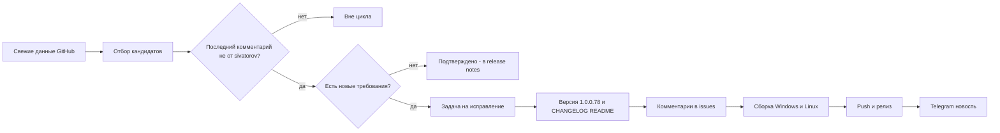

# План исправлений для версии v1.0.0.78

Репозиторий: https://github.com/sivatorov/Workspace1C
Рабочая копия: `g:/h/Workspace1C` (ветка `main`)
Текущая версия: **v1.0.0.77** → целевая: **v1.0.0.78** (увеличиваем ТОЛЬКО последнее число; в [`Workspace1C.csproj`](Workspace1C/Workspace1C.csproj:62) четыре тега: `Version`/`AssemblyVersion`/`FileVersion`/`InformationalVersion`).

## Правило отбора

Проанализированы **все 6 открытых issues** (данные GitHub API от 2026-10-26). В работу берутся только те, где **нет комментариев** или **последний комментарий НЕ от `sivatorov`**. Issues **не закрываем** — только комментарий «Исправлено в 1.0.0.78 …».

| Issue | Название | Последний комментарий | Решение |
|-------|----------|----------------------|---------|
| #69 | Удаление из кластера | @7OH 12:19: блокировка регламентных заданий галочкой; не выходить после первой неудачной попытки завершения сеансов | **Исправляем** |
| #63 | Доработка публикации баз | @7OH 12:25: «Файл алиаса по прежнему не вернулся» | **Исправляем** |
| #41 | Миграция баз | @7OH 10:19 → ссылка на comment 6403469458: починить индексы статуса; пропускать ошибки и обрабатывать остальные базы | **Исправляем** |
| #57 | Общая авторизация | @7OH 17:08 (10-25): «Есть - теперь раздельно» — подтверждение, новых требований нет | **Правок кода нет** — упоминание в release notes |
| #54 | Массовые действия | @sivatorov 11:53 (фикс 1.0.0.77) — последний комментарий владельца | вне цикла |
| #55 | Поправить формы | @sivatorov 11:53 (фикс 1.0.0.77) — последний комментарий владельца | вне цикла |

## Принципы

1. **Двухплатформенность.** Каждая правка — WPF (Windows) и Avalonia (Linux): чистая логика (сервисы/VM/парсеры) общая + юнит-тесты; представления — парные файлы `*.xaml`/`*.xaml.cs` и `*.axaml`/`*.Avalonia.cs`.
2. **Тесты-стражи.** После каждой правки — юнит-тесты в `Workspace1C.Tests/` по образцу существующих (`Issue69DropRetryWindowLayoutTests`, `Apache27ConfRegressionTests`, `ClusterMigrationViewModelTests`).
3. **Обратная совместимость.** Не ломать старые конфиги и локализацию ru/en.
4. **Issues не закрываются** — фиксируем факт в комментариях и release notes.
5. **Версия** увеличивается один раз на цикл: 1.0.0.77 → **1.0.0.78**.
6. **Каждый пункт — в новой задаче** (`new_task`), планирование — в режиме Архитектора.

---

## 1. Issue #69 — «Удаление из кластера» · объём M

### 1.1. Требования (последний комментарий 7OH от 2026-10-26 12:19)

1. «Если соединение не снимается — предлагать на форме галочкой **"Установить блокировку регламентных заданий"**: при повторном нажатии "Завершить сеансы и повторить" — сначала ставить блокировку, а потом снимать сеансы».
2. «Не выходить после первой попытки с завершением, если не удалось. Иногда повторная попытка может помочь, просто соединение не успело закрыться».

### 1.2. Текущий код

- [`ServerMonitorViewModel.DropSelectedInfobaseAsync`](Workspace1C/ViewModels/ServerMonitorViewModel.cs:711) — цикл повтора; при `answer.TerminateSessions` вызывается `TerminateInfobaseActivityAsync`; **если завершение сеансов не удалось — `ShowWarningOnUi` + `return` (выход из цикла)** — это и есть поведение «выходит после первой попытки», которое надо убрать.
- [`RacInfobaseDropRetryWindow.xaml.cs`](Workspace1C/Views/RacInfobaseDropRetryWindow.xaml.cs:28) и [`RacInfobaseDropRetryWindow.Avalonia.cs`](Workspace1C/Views/RacInfobaseDropRetryWindow.Avalonia.cs:36) — флаг `TerminateSessions`, поля Логин/Пароль, кнопки «Завершить сеансы и повторить»/«Повторить попытку»/«Отмена».
- [`DropRetryResult.cs`](Workspace1C/ViewModels/DropRetryResult.cs) — результат диалога.
- rac-команда блокировки регламентных заданий уже реализована: `RacClient.UpdateInfobaseAsync` с `--scheduled-jobs-deny=on` ([`RacInfobaseUpdateRequest.ScheduledJobsDeny`](Workspace1C/Models/RacInfobaseUpdateRequest.cs:48)); используется в окне свойств ИБ.

### 1.3. Конкретные правки

1. **Диалог:** добавить галочку «Установить блокировку регламентных заданий» (WPF `RacInfobaseDropRetryWindow.xaml` + Avalonia `RacInfobaseDropRetryWindow.Avalonia.cs`); локализация ru/en (`ServerMonitor.Infobase.Drop.BlockScheduledJobs`).
2. **Результат:** в `DropRetryResult` добавить `BlockScheduledJobs`; пробросить через `AskDropRetryOnUi` (как `TerminateSessions`).
3. **Порядок в `DropSelectedInfobaseAsync`:** если `answer.BlockScheduledJobs` — сначала `RacClient.UpdateInfobaseAsync` c `ScheduledJobsDeny=true` (креды администратора кластера), затем `TerminateInfobaseActivityAsync`, затем повторный drop; статус показывает промежуточные шаги.
4. **Не выходить после неудачного завершения:** при `!termOk` **не возвращаться**, а снова показать диалог повтора (продолжить цикл), пометив «Повторная попытка завершения сеансов не удалась…»; пользователь может нажать «Завершить сеансы и повторить» ещё раз.
5. **Тесты:** `ServerMonitorViewModelTests` (блокировка сначала, повторный показ диалога после неудачного завершения, «Отмена» прерывает), `RacClientTests` (аргументы `--scheduled-jobs-deny=on`), `Issue69DropRetryWindowLayoutTests` (галочка на WPF и Avalonia).

### 1.4. Риски

- rac 8.3/8.5 формат `infobase update` уже покрыт `UpdateInfobaseAsync` — проверить передачу `--infobase` при блокировке; в тестах проверить аргументы.

---

## 2. Issue #63 — «Доработка публикации баз» · объём M

### 2.1. Требование (последний комментарий 7OH от 2026-10-26 12:25)

«Файл алиаса по прежнему не вернулся» (+ скриншот окна публикации). В 1.0.0.77 заявлено «возвращён выбор include-файла алиасов (ConfTargets)», но в списке по-прежнему нет файла алиасов.

### 2.2. Текущий код

- [`WebPublishViewModel.BuildConfTargets`](Workspace1C/ViewModels/WebPublishViewModel.cs:260) — список `ConfTargets` строится из `instance.ConfPath` (основной конфиг из `-f`) + `instance.IncludeFiles` (граф Include). Если `1c8Aliases27.conf` не попадает в `IncludeFiles` — в списке его нет, либо `HasConfTargets == false`.
- Включение алиасов в графе реальных конфигов: `httpd27.conf → httpd.conf → 1c8Aliases27.conf` (регресс-фикстуры `TestData/Apache27Conf`, тест `Apache27ConfRegressionTests`).
- Возможные причины «не вернулся»: include алиасов идёт через `IncludeOptional`/шаблон/подкаталог `conf\aliases\` и не захватывается; парсер кладёт пути в `IncludeDirectories`, а VM использует `IncludeFiles`; либо файл резолвится, но дублируется с основным конфигом и отсекается `seen`.

### 2.3. Конкретные правки

1. **Диагностика:** прогнать `ApacheInstanceDetector`/`ApacheConfIncludeParser` на фикстурах `TestData/Apache27Conf`; проверить, что `1c8Aliases27.conf` присутствует в `IncludeFiles` (или попадает в `ConfTargets`).
2. **Правка детектора/парсера:** при необходимости добавить захват include-файлов алиасов (в т.ч. через `IncludeOptional`, относительные пути от конфига владельца, имена `1c8Aliases*.conf`/`*.conf` из include-каталога `IncludeDirectory`), без дубликатов и без неразрешённых `${...}`.
3. **VM:** убедиться, что `BuildConfTargets` включает файл алиасов как отдельный пункт «Include: 1c8Aliases27.conf»; при необходимости fallback-поиск известных имён алиасов рядом с основным конфигом.
4. **Значения по умолчанию из конфига службы (`-f`)** и ширина поля 400px — уже в 1.0.0.77; сверить, что не регрессировали (тесты `ApacheInstanceDetectorTests`, `WebPublishServerComboBoxWidthTests`).
5. **Тесты:** расширить `Apache27ConfRegressionTests` (aliases в ConfTargets), `WebPublishIssue63Tests` (список ConfTargets содержит файл алиасов), `ApacheConfIncludeParserTests`.

### 2.4. Риски

- Шаблоны `Include conf\aliases\*.conf` — не тащить весь каталог, только реально существующие файлы; тест-фикстуры уже в репозитории (27_conf.zip из комментария).

---

## 3. Issue #41 — «Миграция баз» · объём M

### 3.1. Требования (последний комментарий 7OH от 2026-10-26 10:19 → comment 6403469458)

Пример пользователя (3 базы: без ошибки, ошибка «есть в кластере, но нет в БД», без ошибки):
- при обработке 2-й базы статус показывает имя 1-й; после снятия галочки и повторного запуска — статус показывает 2-ю, хотя копируется 3-я;
- первая база добавилась в кластер, но **не добавилась в список**.
1. «Починить индексы».
2. «Пропускать ошибки и пытаться обработать остальные выделенные. Всё, что с ошибками, и так останется в списке с галочками — сможем увидеть».

### 3.2. Текущий код

- [`ClusterMigrationViewModel.MigrateAsync`](Workspace1C/ViewModels/ClusterMigrationViewModel.cs:986) — перебор строк: `ProgressIndex = i + 1; CurrentBaseName = name` ([`ClusterMigrationViewModel.cs:1087`](Workspace1C/ViewModels/ClusterMigrationViewModel.cs:1087)); при ошибке (create/drop) вероятно `break`/ранний выход → остальные базы не обрабатываются; добавление в группу идёт в конце — при раннем выходе база в кластере есть, но в список не добавлена.
- Статус для строки «Есть в кластере, но нет в сервере БД» — ошибка создания; должен помечаться и пропускаться.

### 3.3. Конкретные правки

1. **Индексы:** статус `CurrentBaseName`/`ProgressIndex` привязывать к фактически обрабатываемой строке (не смещать при снятии галочек/перезапуске); добавить счётчик обработанных.
2. **Continue-on-error:** при ошибке переноса конкретной базы — не прерывать цикл: отметить строку ошибкой, сохранить галочку/статус «Ошибка», перейти к следующей.
3. **Добавление в список:** успешно перенесённые базы добавлять в группу по мере успеха (или в конце по фактически успешному списку), чтобы «есть в кластере, но нет в списке» не случалось; ошибки не роняют финальную сводку.
4. **Сводка:** итог «Перенесено: N · Ошибок: M»; после миграции автоматически обновлять статусы приёмника (уже есть в 1.0.0.74 — сверить).
5. **Тесты:** `ClusterMigrationViewModelTests` (статус соответствует текущей базе, ошибка одной базы не останавливает остальные, проблемная строка сохраняет галочку, успешные добавляются в список), `ClusterMigrationServiceTests` (по-базовые результаты).

### 3.4. Риски

- «Есть в кластере, но нет в сервере БД» — rac может вернуть ошибку создания БД; важно не считать такую базу удалённой из источника и не добавлять повторно.

---

## 4. Версия, CHANGELOG, README

1. [`Workspace1C.csproj`](Workspace1C/Workspace1C.csproj:62): `Version`/`AssemblyVersion`/`FileVersion`/`InformationalVersion` → **1.0.0.78**.
2. [`CHANGELOG.md`](CHANGELOG.md): новая секция `## [1.0.0.78] — 2026-10-26` с разделами «Добавлено»/«Исправлено» по #69, #63, #41 (со ссылками на файлы) + «Подтверждено» (issue #57).
3. [`README.md`](README.md): бейдж версии, «актуальная версия», количество тестов, пункты возможностей (по образцу записей 1.0.0.77).

---

## 5. Комментарии в issues

Комментарий в каждый исправленный issue (#69, #63, #41) по образцу `_issue*_comment*.md`: «Исправлено в версии 1.0.0.78 (Windows и Linux) …» с описанием правок, ссылками на файлы, тестами и ссылкой на релиз. Issues **не закрывать**.

---

## 6. Сборка и релиз

1. Собрать Windows (WPF): `dotnet publish` self-contained (`publish/`).
2. Собрать Linux (Avalonia): `dotnet publish` с `-p:BuildLinux=true` (`package/linux/`).
3. Push в `main`.
4. Создать релиз `v1.0.0.78` с release notes (по образцу `_rel_notes_v100077.md`), прикрепить оба исполняемых файла.
5. Отправить новость в Telegram-канал `-1004425443528` (по образцу `_send_telegram_v100077.ps1` / `_telegram_msg_v100077.txt`).

---

## Порядок выполнения (каждый пункт — новая задача)

1. Задача (code): исправить #69.
2. Задача (code): исправить #63.
3. Задача (code): исправить #41.
4. Задача (code): версия 1.0.0.78 + CHANGELOG + README.
5. Задача (code): комментарии в issues (#69, #63, #41).
6. Задача (code): сборка Windows + Linux.
7. Задача (code): push + релиз v1.0.0.78.
8. Задача (code): Telegram-уведомление.
